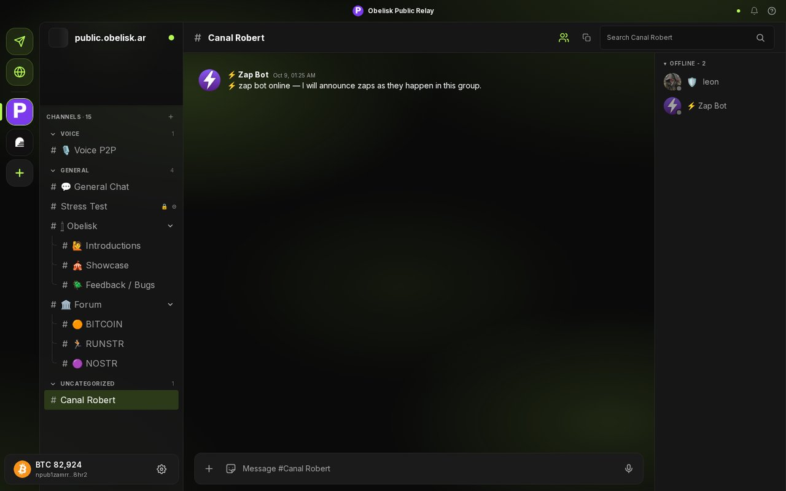
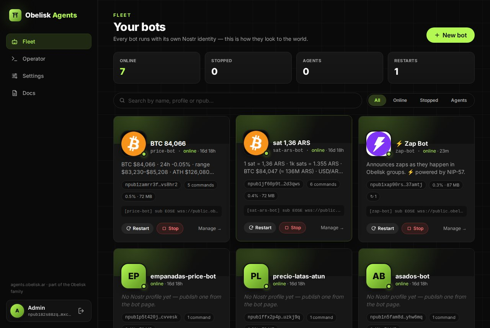
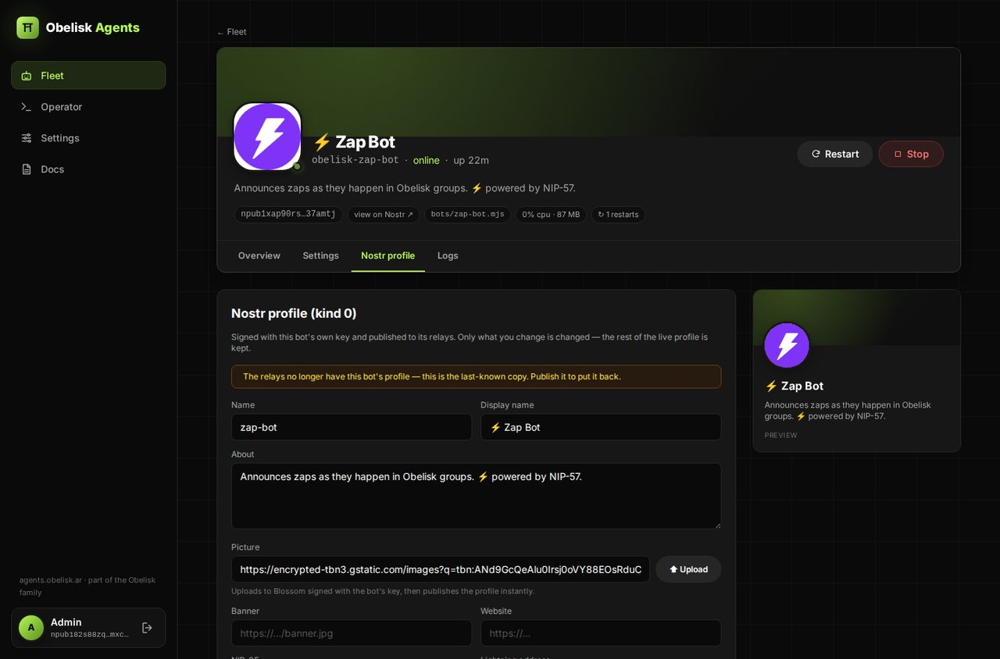
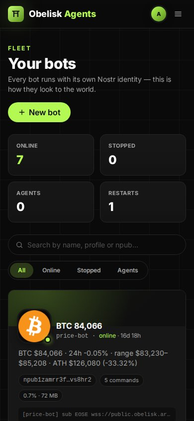

<div align="center">

<a href="https://agents.obelisk.ar"></a>

<p>
  <a href="https://agents.obelisk.ar"></a>
  <a href="https://github.com/obelisk-app/obelisk-agents/stargazers"></a>
  <a href="https://github.com/obelisk-app/obelisk-agents/commits/main"></a>
  <a href="https://github.com/obelisk-app/obelisk-agents/graphs/commit-activity"></a>
</p>
<p>
  
  
  
  
  
  
</p>

<h3>
  <a href="https://agents.obelisk.ar">🤖 Fleet manager</a>
  &nbsp;·&nbsp;
  <a href="https://obelisk.ar">🗿 Obelisk</a>
  &nbsp;·&nbsp;
  <a href="#quickstart-run-the-price-bot">⚡ Quickstart</a>
  &nbsp;·&nbsp;
  <a href="./docs/building-bots.md">🛠️ Build a bot</a>
</h3>

</div>

Nostr bots for the Obelisk ecosystem (NIP-29 groups). Each bot is a small
Node process that holds its own `nsec`, talks directly to relays, and
publishes events. Two types exist: **bots** (scripted — tickers, announcers)
and **agents** (LLM-connected members that only hear whitelisted users; see
[docs/agents.md](./docs/agents.md)). All are plain Nostr clients supervised
by PM2, managed from https://agents.obelisk.ar.

## 💬 Say `!btc`, get an answer

<div align="center">
  
</div>

<table>
<tr>
<td width="50%"></td>
<td width="50%"></td>
</tr>
<tr>
<td><b>Bots are real group members.</b> Zap Bot introducing itself in an Obelisk channel. Note the price bot's name in the corner: its kind:0 display name <i>is</i> the ticker.</td>
<td><b>The fleet at agents.obelisk.ar.</b> Every bot with its live Nostr profile, status, uptime, memory and last log line. Restart or stop in one click.</td>
</tr>
</table>


## 🤖 The bots

| Bot | Talks | What it does |
|---|---|---|
| ₿ **price-bot** | `!btc` `!price` `!ath` `!stats` `!help` | BTC/USD from CoinGecko. Also a *profile ticker*: its display name is the price. |
| 🇦🇷 **sat-ars-bot** | `!sat` `!sats` `!btc` `!ars` `!stats` `!help` | sat/ARS from yadio.io: what a sat is worth in pesos, and the other way round |
| ⚡ **zap-bot** | — | Announces zap receipts (kind 9735) as they happen: `⚡ calle sent 21 satoshis to jack` |
| 🏆 **lacrypta-ranks** | `!rangos` `!ranking` `!milugar` `!perfil` `!xpinfo` `!cierre` `!fbi` … | Nostr port of La Crypta's Discord ranks bot: XP for messages, reactions and zaps, levels and a fortnightly ranking |
| 🥩 **asados-bot** | `!asado` | Last checked price per kg of tapa de asado at DIA Argentina |
| 🥟 **empanadas-price-bot** | `!empanada` | The current empanada price in Buenos Aires |
| 🐟 **precio-latas-atun** | `!atun` | Last checked price of a 170 g DIA tuna can |
| 🧠 **agents** | when mentioned | LLM-connected members, scaffolded with `new-bot --agent`. They only hear whitelisted users. |

Each bot's commands live next to it in `bots/<name>.commands.json`.

## ⌨️ From zero to a bot in a group

<div align="center">
  
</div>

<details>
<summary><b>📸 More of the manager</b></summary>
<br>
<table>
<tr>
<td width="72%"></td>
<td width="28%"></td>
</tr>
<tr>
<td>A bot's page: edit its Nostr profile (kind 0), signed with the bot's own key. Pictures upload to Blossom.</td>
<td>The fleet on a phone.</td>
</tr>
</table>
</details>


## 🌐 The Obelisk family

| Repo | What |
|------|------|
| 🗿 [obelisk-app/obelisk](https://github.com/obelisk-app/obelisk) | The chat app (relay-only) · [obelisk.ar](https://obelisk.ar) |
| 📡 [obelisk-app/obelisk-relay](https://github.com/obelisk-app/obelisk-relay) | NIP-29 groups relay |
| 🎙️ [obelisk-app/obelisk-sfu](https://github.com/obelisk-app/obelisk-sfu) | mediasoup SFU for voice |
| 🏝️ [obelisk-app/obelisk-sky](https://github.com/obelisk-app/obelisk-sky) | A 3D village client · [sky.obelisk.ar](https://sky.obelisk.ar) |
| 🤖 [**obelisk-app/obelisk-agents**](https://github.com/obelisk-app/obelisk-agents) | This repo — bots toolkit |
| 🏛️ [obelisk-app/obelisk-classic](https://github.com/obelisk-app/obelisk-classic) | The original centralized stack |

## 🗂️ What's in here

```
bots/                 one .mjs file per long-running bot
  price-bot.mjs           BTC/USD ticker (CoinGecko; replies to !btc / !ath / ...)
  price-bot.cleanup.mjs   one-shot cleanup of duplicate startup hellos
  sat-ars-bot.mjs         sat/ARS ticker (yadio.io; replies to !sat / !btc / !ars / ...)
  zap-bot.mjs             [WIP] announces zap receipts/reactions with dynamic group discovery
  (agents)                LLM-connected bots scaffolded with new-bot --agent (lib/agent-bot.mjs)
tools/                management utilities you run by hand or from a coding agent
  new-bot.mjs             scaffold a new bot + generate its nsec
  whoami.mjs              decode an nsec env var → npub
  set-profile.mjs         publish kind:0 (edit a bot's display name / picture / about)
  grant-admin.mjs         publish kind 9000 to add a pubkey as admin (or any role)
  add-member.mjs          publish kind 9000 to add a pubkey as plain member
  list-groups.mjs         enumerate kind 39000 group metadata on a relay
  probe-relays.mjs        scan groups across multiple relays with AUTH
  probe-zaps.mjs          query kind 9735 / 9734 history across relays
  probe-write.mjs         per-kind write permission check against a relay
  simulate-zap.mjs        publish a synthetic kind 9735 to test the announcer
  show-profile.mjs        read back each relay's stored kind:0 for a pubkey
  inspect-events.mjs      dump every kind in a given (relay, groupId) window
  recent-all.mjs          tally every kind across all groups on a relay
lib/                  shared helpers (parseSecret, createPool with NIP-42 auth)
  group-watcher.mjs       dynamic NIP-29 group discovery (kind 39000 watcher)
server/               management API (Nostr auth, PM2 control, env editor, Codex operator)
frontend/             management UI (Preact + Vite + Tailwind) → https://agents.obelisk.ar
ecosystem.config.cjs  PM2 process list — one entry per bot
.env.example          copy to .env.local and fill in
docs/                 design notes (taxonomy, admin-bot pattern, discovery)
```

## 🖥️ Web manager — agents.obelisk.ar

The fleet has a web control plane at **https://agents.obelisk.ar** (the older
bots.obelisk.ar URL still works as an alias) (code in
`server/` + `frontend/`, reusing the obelisk-relay frontend stack and
design). Sign in with the admin Nostr key (NIP-07 extension or nsec —
challenge-signed kind 22242, same as the relay admin panel). It can:

- start / stop / restart every bot (PM2 under the hood) and tail logs
- edit **all** settings and relay/group lists (`.env.local`, secrets
  write-only and never sent to the browser)
- publish bot profiles (kind 0), browse groups on a relay, scaffold new
  bots
- run the **Operator**: a Codex CLI agent with shell access to this repo,
  usable with either a **ChatGPT/Codex subscription** or **API credits**
  (it rides `~/.codex/auth.json`, hermes-agent style) — it follows
  [AGENTS.md](./AGENTS.md) and [docs/building-bots.md](./docs/building-bots.md)

Admin allow-list: `MANAGER_ADMIN_NPUBS` in `.env.local` (defaults to the
owner npub). Local dev: `npm run frontend:build && npm run manager`,
then open http://127.0.0.1:3021.

## 📦 Install

```bash
git clone https://github.com/obelisk-app/obelisk-agents.git
cd obelisk-agents
npm install
cp .env.example .env.local   # then fill in BOT_NSEC etc.
```

Node 20+ required. The npm scripts pass `--env-file-if-exists=.env.local`
automatically — no `dotenv` dependency.

## Quickstart: run the price bot

1. Generate a nsec for the bot:
   ```bash
   npm run new-bot -- price-bot   # or use an existing nsec
   ```
   (Skip if you already have a `BOT_NSEC` in `.env.local`.)

2. Whitelist the printed npub on `wss://public.obelisk.ar` if it enforces
   an allow-list.

3. Add the bot to one or more groups (run as a *human* admin):
   ```bash
   ADMIN_NSEC=<your-admin-nsec> \
   TARGET_GROUP="wss://public.obelisk.ar|<groupId>" \
   TARGET_PUBKEY=<bot-npub> \
     npm run add-member
   ```

4. Set `BOT_GROUPS` in `.env.local`:
   ```
   BOT_GROUPS=wss://public.obelisk.ar|<groupId>
   ```

5. Start under PM2:
   ```bash
   npm run pm2:start
   pm2 logs obelisk-price-bot
   ```

## 🧬 Bot taxonomy

| Type | Identity | Privileges needed | Examples |
|---|---|---|---|
| Profile bot | own nsec | none — publishes own kind:0 | price-bot (BTC ticker as display name) |
| Group member bot | own nsec | admitted via kind 9000 | price-bot when posting kind 9 / showing in member list |
| Admin bot | nsec with admin role | listed in kind 39001 | welcome-bot, role-assigner, content-mod |
| Relay-operator bot | nsec on relay allow-list | relay-side write permission | any bot publishing to a closed relay |

A single bot can wear multiple hats (price-bot is a profile bot first; once
admin adds it to a group it's also a member bot).

## 📐 Conventions

- **Language**: Node ESM. Plain `.mjs` under `bots/`. No build step.
- **Nostr lib**: `nostr-tools` (`SimplePool`, `finalizeEvent`, `nip19`,
  `getPublicKey`). Bots do **not** use NDK.
- **WebSocket**: `useWebSocketImplementation(WebSocket)` from
  `nostr-tools/pool` plus the `ws` package — Node has no native WebSocket.
- **Identity**: bots own their nsec. Never reuse a human's nsec for a bot.
- **Secrets**: live in `.env.local` (gitignored, mode 600 recommended).
- **Supervisor**: PM2. Each bot is its own process so it can be restarted,
  logged, and monitored independently.
- **Default relay**: `wss://public.obelisk.ar`. Add public relays to
  `BOT_RELAYS` only when the bot's profile (kind:0) needs to be globally
  visible.
- **Filters as struct, not array**: relay29-derived relays reject
  multi-filter REQs. Use `pool.subscribe(relays, singleFilter, params)`,
  not `subscribeMany`.

## 🔧 Operations

| Task | Command |
|---|---|
| Start every bot in `ecosystem.config.cjs` | `npm run pm2:start` |
| Restart all bots | `npm run pm2:restart` |
| Tail logs | `npm run pm2:logs` |
| Restart one bot | `pm2 restart obelisk-price-bot` |
| Clean up duplicate hello messages | `npm run price-bot:cleanup` |
| Decode an nsec → npub | `npm run whoami -- BOT_NSEC` |
| Discover group ids | `npm run list-groups -- wss://public.obelisk.ar` |

## 🔐 Security notes

- Bot nsecs are functionally root for that identity. Treat `.env.local`
  like a credential store.
- An admin bot can ban members, rename the group, change images. Scope
  its capabilities by the events it actually emits — don't grant the
  admin role unless the bot needs kind 9000–9007 powers.
- Bots run server-side and can read plaintext `BOT_NSEC`. Anyone with
  shell access to this host can impersonate them. Rotate the nsec if you
  suspect compromise (and re-issue the kind 9000 add-user with the new
  pubkey).

## 📚 See also

- [AGENT.md](./AGENT.md) — cheat sheet for coding terminal agents (Claude
  Code, Codex, Cursor) to drive this repo.
- [docs/building-bots.md](./docs/building-bots.md) — build a new bot end to
  end (agent-oriented, incl. the Nostr/NIP-29 communication guide).
- [docs/agents.md](./docs/agents.md) — the LLM-connected agent type.
- [docs/managing-bots.md](./docs/managing-bots.md) — full guide to
  creating, configuring, and managing bots from the CLI.
- [docs/price-bot.md](./docs/price-bot.md) — BTC/USD bot operational guide.
- [docs/sat-ars-bot.md](./docs/sat-ars-bot.md) — sat/ARS bot operational guide.
- [docs/zap-bot.md](./docs/zap-bot.md) — NIP-57 zap announcer guide.
- [docs/admin-bot.md](./docs/admin-bot.md) — design pattern for admin /
  moderation bots.
- [docs/discovery.md](./docs/discovery.md) — how to enumerate groups on a
  relay.

<div align="center">
<br>
<a href="https://star-history.com/#obelisk-app/obelisk-agents&Date">
  <picture>
    <source media="(prefers-color-scheme: dark)" srcset="https://api.star-history.com/svg?repos=obelisk-app/obelisk-agents&type=Date&theme=dark">
    
  </picture>
</a>

If a bot made your group better, a ⭐ helps other communities find them.
</div>
